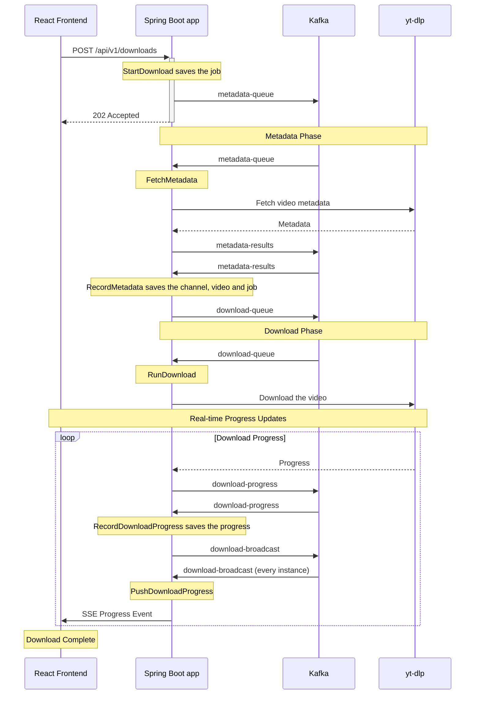
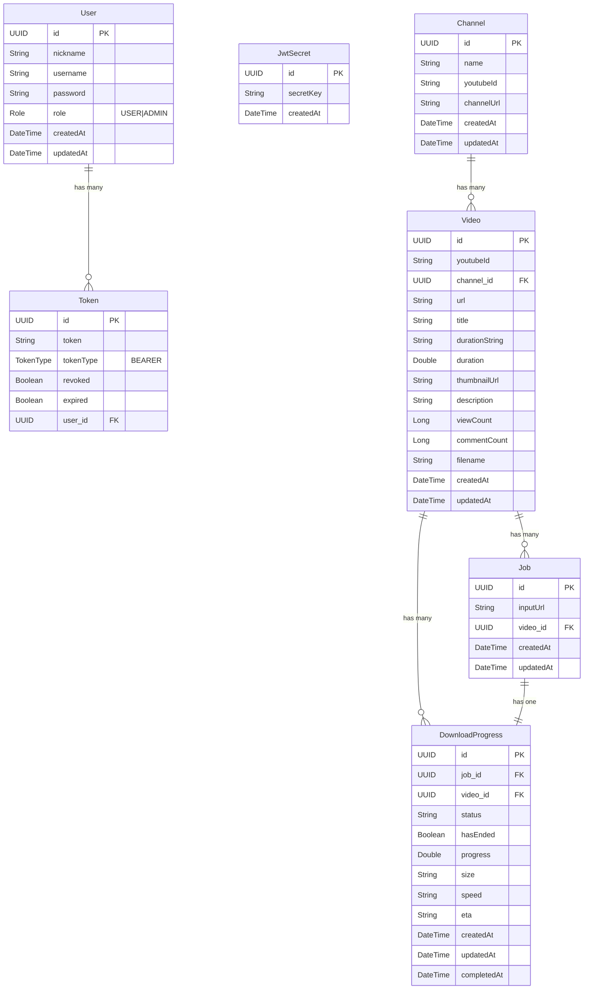

# Tailkeep - YouTube Video Archiver

[Demo Website](https://demo.tailkeep.org/)

## Description

Tailkeep is a free and open-source web application designed to help users download and archive YouTube videos. The primary motivation behind this project is to give users control over their data, especially in the context of the increasing tendency of big tech companies like YouTube to remove videos due to copyright strikes or other reasons. This is particularly relevant for music videos, song remixes, movie soundtracks and other content that might be taken down.

## Motivation

- **Control Over Data:** Users can have their own copies of videos, ensuring they are not lost due to removal from YouTube.
- **Preservation of Content:** Helps in archiving videos that might be removed due to copyright issues or creator's decisions.

## Features

- Download and archive YouTube videos.
- View and manage downloaded videos through a user-friendly dashboard.
- Store video metadata for easy retrieval and management.

## Architecture

The application is structured into three main components:

1. **App:** One Spring Boot application, in `backend/`. It handles the business logic and JWT authentication, serves the web UI and runs the downloads in the background through yt-dlp.
2. **Web:** React web UI, built into the app's image.
3. **Media:** Go server used for serving static video and image files.

### Backend Modules

The app is a modular monolith with a hexagonal architecture: one deployable, with the business logic in a plain Java domain and the technology in adapters around it. Every adapter depends only on the domain, never on another adapter, and the build fails if that changes.

| Module                           | Contains                                                                      |
| -------------------------------- | ----------------------------------------------------------------------------- |
| `mod-domain`                     | Models, use cases and ports, by feature: `video`, `channel`, `download`, `user`, `auth`. No Spring, JPA, Kafka or yt-dlp |
| `mod-adapter/database`           | JPA entities and repositories, implementing the persistence ports             |
| `mod-adapter/database-migration` | Flyway migrations                                                             |
| `mod-adapter/web`                | REST controllers, Server-Sent Events, serving the web UI                      |
| `mod-adapter/security`           | Spring Security, JWT, password hashing                                        |
| `mod-adapter/messaging`          | Broker-neutral publishers and handlers, plus the Kafka adapter                |
| `mod-adapter/ytdlp`              | Metadata fetching and downloading through yt-dlp                              |
| `mod-application`                | Main class, application config, full-stack tests                              |

A request comes in through an adapter (`web` or `messaging`), which calls a use case. The use case calls ports, which other adapters implement. Replacing yt-dlp or adding a message broker means a new adapter, with no changes to the domain.

### Technologies Used

- **Java**
- **Spring Boot**
- **Lombok**
- **TypeScript**
- **React**
- **Vite**
- **TanStack Router**
- **Tailwind CSS**
- **Server-Sent Events (SSE)**
- **PostgreSQL**
- **Apache Kafka**
- **PNPM**
- **Docker**
- **Traefik**

### Message Queues

The system uses Apache Kafka message queues for handling background tasks. This ensures that video downloading and processing tasks do not interfere with the main application's performance.

The following Kafka topics are used in the system:

| Topic               | Description                                                |
| ------------------- | ---------------------------------------------------------- |
| `metadata-queue`    | Used to request video metadata from yt-dlp                 |
| `metadata-results`  | Used to send back the fetched video metadata               |
| `download-queue`    | Used to request a video download                           |
| `download-progress` | Used to send real-time download progress updates           |
| `download-broadcast`| Tells every app instance that a download changed, so each pushes it to its own SSE clients |

Every step of a download runs as a use case, started by a message, so an app instance that dies in the middle of a step gets that message redelivered to the next one. All instances run all the steps. Below is the sequence diagram showing the complete flow of a video download request:

### Database Schema

Below is the Entity Relationship Diagram showing the database structure:

## Upgrading from the separate api and worker images

The API and the worker now run as one application in one image, `ghcr.io/oliverilp/tailkeep-java`. The old `tailkeep-java-api` and `tailkeep-java-worker` images are no longer updated. The database, the Kafka topics and the consumer groups are unchanged, so jobs queued before the upgrade carry over.

1. Stop and remove the `api` and `worker` containers first, so the old and the new application never consume the same topics.
2. In your compose file, replace the `api` and `worker` services with one service (`app` in [docker/compose.yml](docker/compose.yml)):
   - image `ghcr.io/oliverilp/tailkeep-java:latest`
   - the `api` environment, plus `MEDIA_PATH=/videos`
   - the `/videos` volume the worker had
   - the `api` Traefik labels (the application still listens on port 8080)
3. Point the media server at the new service: `API_HOST=http://app:8080`.
4. Run `docker compose up -d --remove-orphans`.
